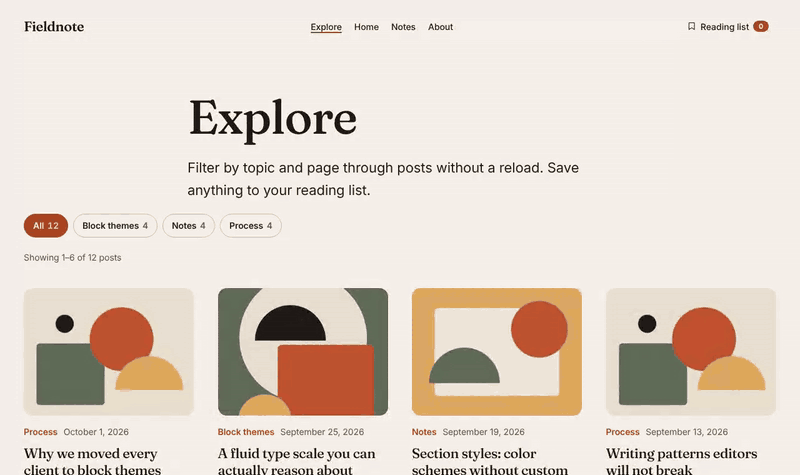
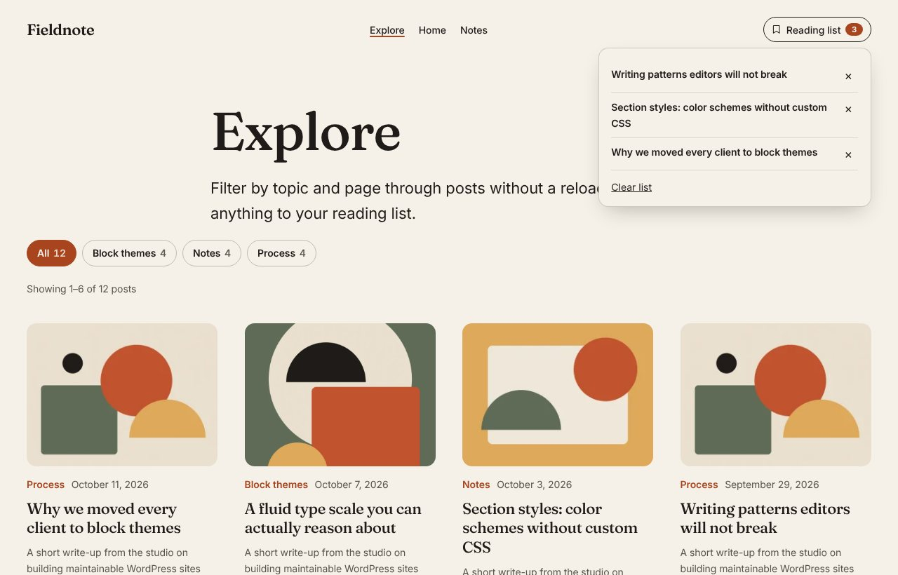

# Fieldnote Interactive

Interactive WordPress blocks built with the **[Interactivity API](https://developer.wordpress.org/block-editor/reference-guides/interactivity-api/)**:

1. **Filterable Post Grid.** Category filters and pagination that update in place using the Interactivity Router. The URL updates, the back button works, and with JavaScript turned off it is still a fully working, server-rendered filter.
2. **Save for Later + Reading List.** A bookmark toggle on posts and a counter in the site header that share one global store, so saving anywhere updates everything instantly. The list persists in `localStorage` and stays in sync across browser tabs.

[](https://playground.wordpress.net/?blueprint-url=https://raw.githubusercontent.com/jdyach/fieldnote-interactive/main/_playground/blueprint.json)

The live demo spins up a real WordPress site in your browser with this plugin, the [Fieldnote block theme](https://github.com/jdyach/fieldnote) and sample posts. Nothing to install.



## How it works

Everything is rendered on the server first, then enhanced with directives. Each feature maps to specific Interactivity API concepts:

| Feature | How it is built |
| --- | --- |
| Filter and page without reloading | Real `<a href="?fi-cat=…">` links with `data-wp-on--click="actions.navigate"`. The action calls `navigate()` from `@wordpress/interactivity-router`, which fetches the same URL and swaps only the `data-wp-router-region`. |
| Router loaded only when needed | The router is pulled in with a dynamic `import()` inside the action, so pages where nobody clicks never download it. `wp-scripts` records it as a `dynamic` module dependency. |
| Instant-feeling clicks | `data-wp-on--mouseenter` and `data-wp-on--focus` call `actions.prefetch` to warm the router cache. |
| Loading state | `data-wp-class--is-loading` and `data-wp-bind--aria-busy` on the block wrapper, driven by `state.isLoading`. |
| Correct `preventDefault()` in an async action | The navigate action is wrapped in `withSyncEvent()` (WordPress 6.8+), which marks actions that need synchronous event access. |
| One store, three blocks | The save button, the grid cards and the header counter all use the `fieldnote-interactive` namespace from a shared module, so state changes propagate everywhere with no custom events. |
| "Is this post saved?" | Each button gets its own `data-wp-context` (`{ id, title, url }`). A single derived getter, `state.isSaved`, reads that context, and `data-wp-bind--aria-pressed` reflects it. |
| Server-rendered first paint | `wp_interactivity_state()` provides defaults, including **derived state closures** for `isSaved`, `hasItems` and `buttonLabel` that PHP evaluates for the initial HTML before the matching JavaScript getters take over. |
| Translated strings in JavaScript | `wp_interactivity_config()` passes translated labels; the store reads them with `getConfig()`. |
| Reading list items | `<template data-wp-each--item="state.items" data-wp-each-key="context.item.id">` renders one row per saved post. |
| Persistence and tab sync | `data-wp-init="callbacks.load"` reads `localStorage` once per page; `data-wp-on-window--storage` keeps other open tabs in sync. |
| Dropdown behavior | `data-wp-on-document--keydown` closes on Escape and returns focus; `data-wp-on-document--click` closes on outside clicks. |
| Zero-config placement | **Block Hooks** in `block.json` auto-insert the Reading List after the header's Navigation block and the Save button after single post titles. A `hooked_block_types` filter scopes them so they never appear in footers or inside Query Loops. |

### Decisions worth calling out

- **Progressive enhancement, verified.** Filters and pagination are plain links handled in PHP (`?fi-cat=`, `?fi-page=`), so the grid works with JavaScript disabled. JS-only controls render with `data-wp-bind--hidden="!state.isReady"`, which the server turns into a real `hidden` attribute, so visitors without JavaScript never see a button that does nothing.
- **Client state that navigation can't clobber.** Router navigations merge the new page's server state without overriding existing keys (I confirmed this in the `@wordpress/interactivity` source), so the server-side defaults never wipe a visitor's saved list.
- **Router region content is plain server HTML.** Nothing inside the region is bound to client state, which avoids the classic bug where a stale client value overwrites freshly navigated content.
- **A subtle bug caught by tests.** Clicking "Remove" in the panel deletes that row before the document-level click handler runs, so `event.target.closest()` found nothing and the panel closed. The handler now uses `event.composedPath()`, which is captured at dispatch time.



## Accessibility

- Toggles use `aria-pressed`; the header button uses `aria-expanded` and `aria-controls` (disclosure pattern).
- The result summary is a `role="status"` live region, so screen readers hear "Showing 1–4 of 4 posts in Process" after each filter.
- After paging, focus moves to the result summary instead of being lost on `<body>`.
- Remove buttons have descriptive labels ("Remove *post title* from reading list").
- Pagination uses `aria-current="page"`; the active filter uses `aria-current="true"`.
- `prefers-reduced-motion` is respected.

## Testing

Verified on WordPress 7.1 (minimum supported: 6.8).

- **12 Playwright end-to-end tests** in `tests/e2e/` cover filtering, pagination, focus, the back button, saving, persistence across navigation and reloads, the panel, block hook placement, the no-JavaScript fallback and hostile query parameters.
- PHP: WordPress Coding Standards, clean.
- JavaScript and CSS: `@wordpress/scripts` ESLint and Stylelint configs, clean.
- The Playground blueprint is validated against Playground's official schema, and its seed script was tested on a fresh install.

```bash
npm install
npm run build          # compiles blocks (viewScriptModule via --experimental-modules)
npm run lint:js && npm run lint:css
composer install && composer lint

# End-to-end tests against any site with the theme, plugin and demo content:
WP_BASE_URL=http://fieldnote.local npm run test:e2e
```

### Continuous integration

GitHub Actions runs PHP syntax checks on 7.4 and 8.3, WordPress Coding Standards, ESLint, Stylelint and a production build. It also fails if the committed `build/` folder or `blueprint.json` is out of date with the source, then uploads an installable plugin zip.

## Project structure

```
fieldnote-interactive/
├── fieldnote-interactive.php      # Registers all blocks from build/blocks-manifest.php
├── includes/
│   ├── helpers.php                # Server state, config strings, shared button markup
│   └── block-hooks.php            # Scopes the auto-inserted blocks
├── src/
│   ├── post-filter/               # block.json, render.php, view.js, editor + front-end styles
│   ├── save-button/
│   ├── reading-list/
│   └── shared/reading-list-store.js   # The store all three blocks share
├── build/                         # Compiled output (committed so the plugin runs without Node)
├── _playground/                   # Blueprint + seed for the live demo
└── tests/e2e/                     # Playwright tests
```

## Installation

1. Download the zip from the latest CI run (Actions → *fieldnote-interactive*), or run `npm run plugin-zip`.
2. In WordPress go to **Plugins → Add New → Upload Plugin** and activate.
3. Add the **Filterable Post Grid** block to any page. With a block theme, the Reading List and Save buttons appear automatically; you can also place them yourself from the inserter.

Works with any block theme; designed alongside [Fieldnote](https://github.com/jdyach/fieldnote). Styles use theme.json presets with sensible fallbacks.

**Requirements:** WordPress 6.8+, PHP 7.4+.

## License

GPLv2 or later. See [LICENSE](LICENSE).

Built by [Jacqui Dyach](https://jacquid.com).
